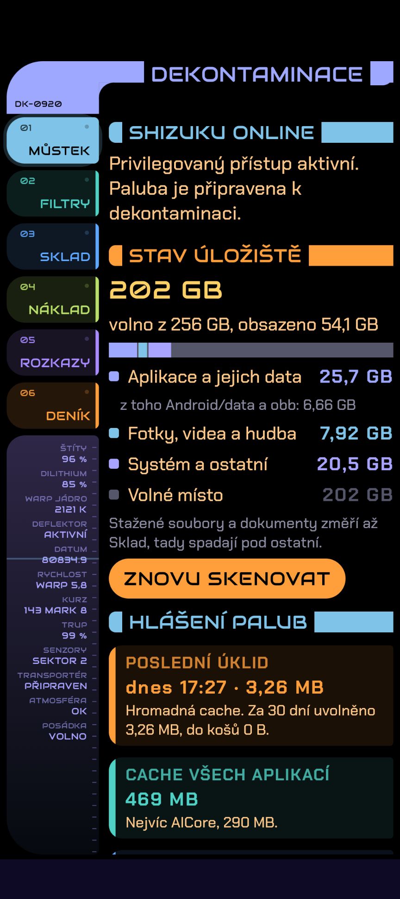
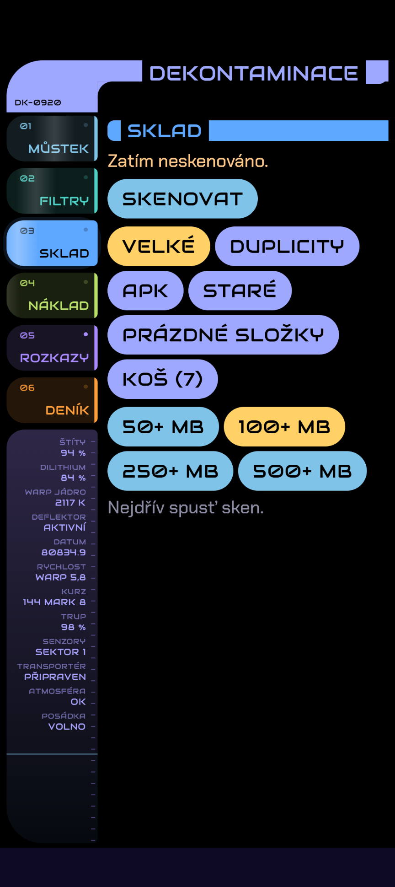

<p align="center"></p>

# Dekontaminace

Vlastní čisticí aplikace pro Android, psaná pro Google Pixel 9a s Androidem 17. Uklízí víc než běžné čističe: cache všech aplikací najednou, velké a duplicitní soubory i složky v `Android/data` a `Android/obb`, kam se běžná aplikace nedostane. Všechno bez rootu, s pomocí aplikace [Shizuku](https://shizuku.rikka.app/).

Rozhraní je laděné jako palubní konzole hvězdné lodi: černé pozadí, barevné segmenty, smyšlené palubní údaje a hvězdné datum. Je to vlastní provedení, bez cizích log a chráněných názvů.

<p align="center">
  
  
</p>

## Moduly

| Modul | Co dělá |
|---|---|
| **01 Můstek** | Přehled: volné místo, rozdělení úložiště, hlášení ze všech modulů (poslední úklid, plné koše, zbytky po odinstalovaných aplikacích), aplikace s největší cache a největší žrouti místa. |
| **02 Filtry** | Cache aplikací. Hromadné uvolnění cache všech aplikací (`pm trim-caches` přes Shizuku) a mazání vnější cache vybraných aplikací. |
| **03 Sklad** | Soubory ve sdíleném úložišti: velké soubory, duplicity podle obsahu (SHA-256), staré screenshoty, nahrávky a stažené soubory, instalační APK, prázdné složky. Mazání přes vlastní koš. |
| **04 Náklad** | `Android/data` a `Android/obb` přes Shizuku: velikost složek po aplikacích, zbytky po odinstalovaných aplikacích, procházení stromem složek, přesun do koše s obnovou. |
| **05 Rozkazy** | Plánovaný úklid na pozadí (WorkManager): hromadná cache denně nebo týdně, se souhrnem v oznámení. |
| **06 Deník** | Historie všech akcí za 90 dní s grafem po dnech (7, 30, 90 dní). |

## Bezpečnost

- Nic se nemaže naslepo. Vždy je vidět co, kolik a jak velké, a akce se potvrzuje.
- Soubory i složky z `Android/data` jdou nejdřív do koše a 7 dní je lze obnovit na původní místo.
- V `Android/data` se přesouvá jen obsah složky aplikace, nikdy složka sama (jinak by k ní aplikace mohla ztratit přístup).
- Plánované rozkazy smí samy dělat jen bezpečné nebo vratné věci.
- Data aplikací (přihlášení, postup ve hrách) aplikace nemaže vůbec.

## Instalace

1. Stáhni APK z [Releases](https://github.com/azuregroove/dekontaminace/releases).
2. Na telefonu povol instalaci z tohoto zdroje a APK nainstaluj.
3. Nainstaluj a spusť [Shizuku](https://shizuku.rikka.app/) (přes bezdrátové ladění; po restartu telefonu je potřeba ho spustit znovu).
4. V Dekontaminaci povol přístup k Shizuku. Ostatní oprávnění (údaje o využití, přístup ke všem souborům) jde udělit přímo z aplikace.

Požadavky: Android 11 (API 30) nebo novější, Shizuku 13 nebo novější. Aktuální APK je ladicí sestavení podepsané ladicím klíčem.

## Sestavení ze zdrojáků

Potřeba je Android Studio (testováno s AGP 9.4, Kotlin 2.2, Compose BOM 2026.02).

```powershell
.\gradlew installDebug   # sestaví a nainstaluje do připojeného telefonu
.\gradlew test           # unit testy (JUnit 4)
```

Cesta k projektu nesmí obsahovat diakritiku, jinak selže kompilace AIDL.

## Struktura

```
app/src/main/java/cz/radek/dekontaminace/
├── MainActivity.kt, *ViewModel.kt   rám aplikace a stav modulů
├── shizuku/                         spojení se Shizuku (UserService přes AIDL)
├── data/                            statistiky úložiště, formátování
├── files/                           sken souborů, duplicity, koš
├── cargo/                           Android/data a obb, koš nákladu (skripty pro shell)
├── rules/                           plánované rozkazy (WorkManager)
├── history/                         deník akcí
└── ui/                              obrazovky modulů a konzolový rám
app/src/test/                        unit testy
```

## Písma a licence

Kód aplikace je pod licencí [MIT](LICENSE): smíš ho volně používat, upravovat i šířit, jen ponech upozornění o autorských právech. Bez záruky, používáš na vlastní riziko.

Písma [Audiowide](https://fonts.google.com/specimen/Audiowide) a [Chakra Petch](https://fonts.google.com/specimen/Chakra+Petch) mají vlastní licenci SIL Open Font License 1.1, texty licencí jsou ve složce [`licenses`](licenses).
